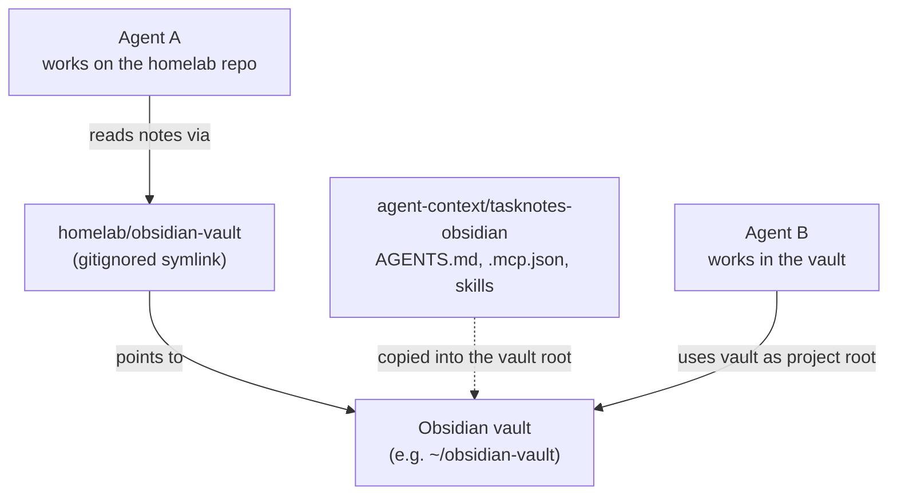

# Agent Context

Context for AI agents (`AGENTS.md` bundles, skills, MCP config) that run on my machines and work on things outside this repo, like the Obsidian vault. Nothing here is deployed by a Compose stack.

In this repo, `obsidian-vault/` is a gitignored symlink to that same vault, so an agent working on the repo and an agent working in the vault see the same files.

This is different from [`.agents/`](../.agents/), which holds the agent configuration for working on this repository itself.

- **[TaskNotes Obsidian](./tasknotes-obsidian/README.md)** - Context bundle for the Obsidian vault and its TaskNotes task management
